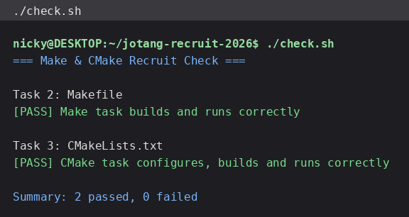

# Task 4：思考题

## 1. Make 和简单的 build.sh 有什么区别？

`build.sh`（把所有 `gcc` 命令从头到尾执行一遍）做的事情是**每次都重新编译全部源文件**，而 Make 的核心是**按依赖关系判断“哪些目标过期了”**，只重做必要的部分。

具体差别：

- **依赖判断 / 增量构建。** Make 会看“目标文件”和“它的依赖”的**修改时间**：`.o` 比 `.c` 新，就跳过这次编译。所以改一个文件后，只重编这个文件对应的 `.o`，再重新链接一次即可（本题实测：`touch src/calculator.c` 后 `make` 只跑了 `gcc -c src/calculator.c` 和最后的链接，`main.o`、`logger.o` 原样复用）。
- **依赖关系写在文件里。** 哪个 `.c` 对应哪个 `.o`、谁 `#include` 了哪个头文件，都写在 Makefile 里（例如 `main.o: src/main.c include/calculator.h include/logger.h`），改头文件时相关目标也会自动重编——这是纯靠脚本很难维护的信息。
- **命令更短、更少出错。** `make`、`make clean` 这样的目标名比每次手敲一长串 `gcc` 好记；命令写在 Makefile 里，不会漏参数、不会打错。
- **可组合、可并行。** `make -j4` 能并行构建互不依赖的目标；`build.sh` 想并行就得自己写。

简单说：`build.sh` 是“每次都重做一遍”，Make 是“只重做该做的”，并且把“什么依赖什么”这件事**文档化**在 Makefile 里。

## 2. CMake 是编译器吗？执行 `cmake --build build` 时，最终是谁在编译 C 源文件？

CMake **不是编译器**，它也不直接编译代码。CMake 是**构建系统生成器**：读 `CMakeLists.txt`，按当前平台生成“另一套构建系统”的配置文件。在 Linux + Makefile 生成器下，它生成的是 `build/CMakeFiles/` 里的 Makefile；在 Windows + Visual Studio 下，它会生成 `.sln`/`.vcxproj`。

所以 `cmake --build build` 只是**转手调用**底层构建工具：

```text
CMakeLists.txt --(cmake -S . -B build)--> build/ 下的 Makefile
cmake --build build  --->  调用 make  --->  调用 gcc/cc  ---> 真正编译 C 代码
```

本题 `cmake --build build` 的输出里能看到 `[ 33%] Building C object CMakeFiles/calculator.dir/src/main.c.o` —— 真正把 `.c` 变成 `.o` 的是 **gcc**（通过生成的 Makefile 调用），CMake 只负责“决定怎么构建、准备好构建脚本并启动构建”。

## 3. 如果一个项目有很多 `.c` 文件，只修改了其中一个，为什么通常不希望把所有源文件都重新编译？

因为**重新编译全部源文件的代价随项目规模线性增长，而收益为零**：没被改动的源文件，重新编译出来的目标文件内容完全一样。

- **时间成本。** 小型项目（几个文件）感觉不出来；但 50 个、500 个文件的项目，全量重编可能从几秒变成几分钟甚至更久。C++ 项目尤其明显（头文件被广泛包含、模板实例化多）。
- **打断工作节奏。** 每次改一行都要等全量构建，就不敢频繁编译、频繁验证，反而更容易堆积问题。
- **增量构建还有缓存可用。** 只重编改动的文件，配合 ccache/编译缓存，第二次构建几乎是“秒级”；全量重编则让缓存的作用大打折扣。
- **链接本身也要重做，但那是一次性的、便宜的。** 增量构建的最后一步仍然会重新链接，保证可执行文件是最新的，所以“只重编改动文件”不会让结果变旧。

反过来说，什么时候仍然要全量重编：改了被广泛包含的头文件、改了编译选项/Makefile 本身、或怀疑依赖关系写漏了（例如头文件依赖没写进 Makefile，就会漏编——这也是 CMake 相对手写 Makefile 更省心的原因之一）。

---

## 自检结果

本仓库 `./check.sh` 的运行结果（两个实践任务都通过）：



```text
=== Make & CMake Recruit Check ===

Task 2: Makefile
[PASS] Make task builds and runs correctly

Task 3: CMakeLists.txt
[PASS] CMake task configures, builds and runs correctly

Summary: 2 passed, 0 failed
```

> 🤖 AI 使用说明：本文件的文字答案由本人用 Hermes Agent 协助整理；Makefile 与 CMakeLists.txt 的补全内容均在本地实际构建、运行并跑 `./check.sh` 验证通过（上文截图即真实运行结果）。
